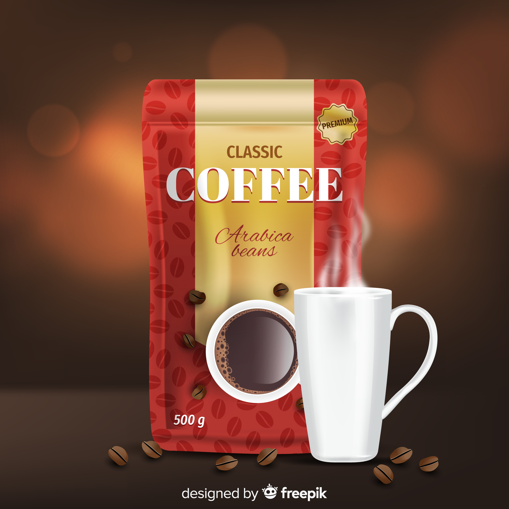

# Coffee Shop Website - API Documentation

## Overview

This documentation covers all public APIs, functions, components, and styling utilities for the Coffee Shop website. The project is a modern, responsive coffee shop website built with HTML5, CSS3, and vanilla JavaScript.

## Table of Contents

1. [Project Structure](#project-structure)
2. [HTML Components](#html-components)
3. [CSS Classes & Utilities](#css-classes--utilities)
4. [JavaScript Functions](#javascript-functions)
5. [Usage Examples](#usage-examples)
6. [Setup & Deployment](#setup--deployment)

## Project Structure

```
/workspace/
├── index.html          # Main HTML file
├── main.js            # JavaScript functionality
├── style.css          # Main stylesheet
├── README.md          # Project documentation
├── images/            # Image assets
│   ├── logo.jpg
│   ├── home.jpg
│   ├── about-us.jpg
│   ├── menu-1.jpg to menu-10.jpg
│   ├── product-1.jpg to product-4.jpg
│   ├── user-1.jpg to user-3.jpg
│   ├── blog-1.jpg to blog-4.jpg
│   └── other.jpg
└── coffe shop.gif     # Demo animation
```

## HTML Components

### 1. Header Component

**Location:** Lines 18-36 in `index.html`

**Description:** Fixed navigation header with logo, navigation menu, and mobile menu toggle.

**Structure:**
- Logo section with image
- Navigation bar with menu items
- Icons section with search, cart, and menu toggle

**HTML Structure:**
```html
<header>
  <a class="logo" href="#">
    
  </a>
  <nav class="navbar">
    <a href="#">Home</a>
    <a href="#">About</a>
    <a href="#">menu</a>
    <a href="#">products</a>
    <a href="#">reviews</a>
    <a href="#">contact</a>
    <a href="#">blogs</a>
  </nav>
  <div class="icons">
    <i class="fa-solid fa-magnifying-glass"></i>
    <i class="fa-solid fa-cart-shopping"></i>
    <i class="fa-solid fa-bars" id="menu-btn"></i>
  </div>
</header>
```

**CSS Classes:**
- `.logo` - Logo container styling
- `.navbar` - Navigation menu container
- `.icons` - Icon container for mobile actions

### 2. Home Section Component

**Location:** Lines 37-49 in `index.html`

**Description:** Hero section with background image and call-to-action content.

**HTML Structure:**
```html
<section class="home">
  <div class="content">
    <h3>Fresh Coffee in the Morning</h3>
    <p>Lorem ipsum dolor sit amet...</p>
    <button class="btn">Get Yours Now</button>
  </div>
</section>
```

**CSS Classes:**
- `.home` - Main hero section with background image
- `.content` - Content wrapper with text and CTA

### 3. About Section Component

**Location:** Lines 50-62 in `index.html`

**Description:** About us section with image and descriptive content.

**HTML Structure:**
```html
<section class="about">
  <h1 class="heading"><span>about</span>us</h1>
  <div class="row">
    <div class="image">
      
    </div>
    <div class="content">
      <h3>Lorem ipsum dolor sit amet.</h3>
      <p>Lorem ipsum dolor, sit amet...</p>
      <button class="btn">Learn More</button>
    </div>
  </div>
</section>
```

**CSS Classes:**
- `.about` - About section container
- `.row` - Flexbox row layout
- `.image` - Image container
- `.content` - Text content container

### 4. Menu Section Component

**Location:** Lines 63-119 in `index.html`

**Description:** Menu items grid displaying coffee products with prices.

**HTML Structure:**
```html
<section class="menu">
  <h1 class="heading"><span>our</span>menu</h1>
  <div class="box-container">
    <div class="box">
      
      <h3>taty and healthy</h3>
      <div class="price">$14.99 <span>$19.99</span></div>
      <div class="btn">Buy Now</div>
    </div>
    <!-- Repeat for menu items 2-10 -->
  </div>
</section>
```

**CSS Classes:**
- `.menu` - Menu section container
- `.box-container` - Grid container for menu items
- `.box` - Individual menu item container
- `.price` - Price display with original and discounted prices

### 5. Products Section Component

**Location:** Lines 120-188 in `index.html`

**Description:** Product showcase with star ratings and pricing.

**HTML Structure:**
```html
<section class="products">
  <h1 class="heading"><span>our</span>products</h1>
  <div class="box-container">
    <div class="product-box">
      <div class="image">
        
      </div>
      <div class="content">
        <h3>Fresh Coffee</h3>
        <div class="stars">
          <i class="fa-solid fa-star"></i>
          <!-- Repeat for 5 stars -->
        </div>
        <div class="price">$12.99 <span>$19.99</span></div>
      </div>
    </div>
    <!-- Repeat for products 2-4 -->
  </div>
</section>
```

**CSS Classes:**
- `.products` - Products section container
- `.product-box` - Individual product container
- `.stars` - Star rating container

### 6. Reviews Section Component

**Location:** Lines 189-230 in `index.html`

**Description:** Customer testimonials with user photos and star ratings.

**HTML Structure:**
```html
<section class="reviews">
  <h1 class="heading"><span>customer's</span>reviews</h1>
  <div class="box-container">
    <div class="box">
      <p>Lorem ipsum, dolor sit amet...</p>
      
      <h3>Musa A.</h3>
      <div class="stars">
        <i class="fa-solid fa-star"></i>
        <!-- Repeat for 5 stars -->
      </div>
    </div>
    <!-- Repeat for users 2-3 -->
  </div>
</section>
```

**CSS Classes:**
- `.reviews` - Reviews section container
- `.box` - Individual review container

### 7. Contact Section Component

**Location:** Lines 231-260 in `index.html`

**Description:** Contact form with Google Maps integration.

**HTML Structure:**
```html
<section class="contact-us" id="contact-us">
  <h1 class="heading"><span>contact</span> us</h1>
  <div class="row">
    <iframe class="map" src="https://www.google.com/maps/embed..."></iframe>
    <form>
      <h3>get in touch</h3>
      <div class="input-box">
        <span><i class="fa-solid fa-user"></i></span>
        <input type="text" placeholder="name">
      </div>
      <div class="input-box">
        <span><i class="fa-solid fa-envelope"></i></span>
        <input type="email" placeholder="email">
      </div>
      <div class="input-box">
        <span><i class="fa-solid fa-phone"></i></span>
        <input type="number" placeholder="phone">
      </div>
      <div class="btn-container">
        <button class="btn">send</button>
      </div>
    </form>
  </div>
</section>
```

**CSS Classes:**
- `.contact-us` - Contact section container
- `.map` - Google Maps iframe styling
- `.input-box` - Form input container with icon

### 8. Blogs Section Component

**Location:** Lines 261-329 in `index.html`

**Description:** Blog posts grid with images, titles, and excerpts.

**HTML Structure:**
```html
<section class="blogs" id="blogs">
  <h1 class="heading">our <span>blogs</span></h1>
  <div class="box-container">
    <div class="box">
      <div class="image">
        
      </div>
      <div class="content">
        <a href="#" class="title">tasty and refreshing</a>
        <span>by admin /22.10.2025</span>
        <p>Lorem ipsum dolor sit amet...</p>
        <button class="btn">read More</button>
      </div>
    </div>
    <!-- Repeat for blogs 2-4 -->
  </div>
</section>
```

**CSS Classes:**
- `.blogs` - Blogs section container
- `.title` - Blog post title link
- `.content` - Blog post content container

### 9. Footer Component

**Location:** Lines 330-351 in `index.html`

**Description:** Footer with social media links, navigation, and copyright.

**HTML Structure:**
```html
<footer>
  <section>
    <div class="share">
      <i class="fa-brands fa-facebook"></i>
      <i class="fa-brands fa-instagram"></i>
      <i class="fa-brands fa-x-twitter"></i>
      <i class="fa-brands fa-pinterest"></i>
      <i class="fa-brands fa-linkedin"></i>
    </div>
    <div class="links">
      <a href="#">Home</a>
      <a href="#">About</a>
      <a href="#">menu</a>
      <a href="#">products</a>
      <a href="#">reviews</a>
      <a href="#">contact</a>
      <a href="#">blogs</a>
    </div>
    <div class="copyright">created by <span> Musa Akyıl </span> all rights reserved</div>
  </section>
</footer>
```

**CSS Classes:**
- `.share` - Social media icons container
- `.links` - Footer navigation links
- `.copyright` - Copyright text container

## CSS Classes & Utilities

### Global Variables (CSS Custom Properties)

**Location:** Lines 18-23 in `style.css`

```css
:root {
  --main-color: #d3ad7f;     /* Primary brand color (golden) */
  --black-color: #13131a;    /* Dark background color */
  --bg-color: #010103;       /* Main background color */
  --border: 0.1rem solid rgba(255, 255, 255, 0.3); /* Border style */
}
```

### Utility Classes

#### `.btn` - Button Component
**Location:** Lines 56-68 in `style.css`

```css
.btn {
  display: inline-block;
  padding: 0.9rem 3rem;
  font-size: 1.7rem;
  background-color: var(--main-color);
  color: white;
  cursor: pointer;
}

.btn:hover {
  scale: 1.1;
}
```

**Usage:**
- Primary action buttons
- Form submit buttons
- Call-to-action elements

#### `.heading` - Section Headings
**Location:** Lines 74-84 in `style.css`

```css
.heading {
  text-align: center;
  font-size: 4rem;
  text-transform: uppercase;
  padding-bottom: 4rem;
}

.heading span {
  color: var(--main-color);
  text-transform: uppercase;
}
```

**Usage:**
- Section titles with highlighted spans
- Consistent typography across sections

#### `.box-container` - Grid Container
**Location:** Multiple locations in `style.css`

```css
.box-container {
  display: grid;
  grid-template-columns: repeat(auto-fit, minmax(30rem, 1fr));
  gap: 1rem;
}
```

**Usage:**
- Menu items grid
- Products grid
- Reviews grid
- Blogs grid

### Layout Classes

#### Header Styles
**Location:** Lines 87-127 in `style.css`

- `.logo` - Logo container with rounded image
- `.navbar` - Navigation menu with hover effects
- `.icons` - Icon container (hidden on desktop, shown on mobile)

#### Section-Specific Classes

**Home Section:**
- `.home` - Full viewport height with background image
- `.home .content` - Content wrapper with max-width

**About Section:**
- `.about .row` - Flexbox layout for image and content
- `.about .row .image` - Image container (flex: 1 1 45rem)
- `.about .row .content` - Content container (flex: 1 1 45rem)

**Menu Section:**
- `.menu .box` - Individual menu item with border and hover effects
- `.menu .box:hover` - White background on hover

**Products Section:**
- `.products .product-box` - Product container with border
- `.products .product-box .image` - Product image container
- `.products .product-box .content` - Product details container
- `.products .product-box .content .stars` - Star rating container

**Reviews Section:**
- `.reviews .box` - Review container with border
- `.reviews .box img` - Circular user avatar
- `.reviews .box .stars` - Star rating display

**Contact Section:**
- `.contact-us .row` - Flexbox layout for map and form
- `.contact-us .row form` - Contact form styling
- `.contact-us .row .map` - Google Maps iframe
- `.contact-us .row form .input-box` - Input field container with icon

**Blogs Section:**
- `.blogs .box` - Blog post container
- `.blogs .box .image` - Blog image with hover scale effect
- `.blogs .box .content` - Blog content container
- `.blogs .box .content .title` - Blog title link with hover color

**Footer Section:**
- `footer .share` - Social media icons container
- `footer .links` - Footer navigation links
- `footer .copyright` - Copyright text styling

### Responsive Design

#### Mobile Styles (max-width: 800px)
**Location:** Lines 476-528 in `style.css`

Key responsive features:
- Mobile navigation toggle
- Adjusted padding and font sizes
- Stacked layout for smaller screens
- Full-width buttons

#### Small Mobile Styles (max-width: 600px)
**Location:** Lines 530-538 in `style.css`

- Reduced base font size (8px)
- Smaller icon sizes

## JavaScript Functions

### Mobile Navigation Toggle

**Location:** Lines 1-10 in `main.js`

```javascript
const navbar = document.querySelector(".navbar");
const menuBtn = document.querySelector("#menu-btn");

menuBtn.addEventListener('click', () => {
    navbar.classList.toggle("active");
});
```

**Function:** `menuBtn.addEventListener`
- **Purpose:** Toggles mobile navigation menu visibility
- **Parameters:** Click event
- **Returns:** None (DOM manipulation)
- **Usage:** Automatically handles mobile menu toggle when hamburger icon is clicked

**Dependencies:**
- Requires elements with classes `.navbar` and ID `#menu-btn`
- Requires CSS class `.navbar.active` for showing mobile menu

## Usage Examples

### 1. Creating a Menu Item

```html
<div class="box">
  
  <h3>Product Name</h3>
  <div class="price">$14.99 <span>$19.99</span></div>
  <div class="btn">Buy Now</div>
</div>
```

### 2. Creating a Product Card

```html
<div class="product-box">
  <div class="image">
    
  </div>
  <div class="content">
    <h3>Product Name</h3>
    <div class="stars">
      <i class="fa-solid fa-star"></i>
      <i class="fa-solid fa-star"></i>
      <i class="fa-solid fa-star"></i>
      <i class="fa-solid fa-star"></i>
      <i class="fa-solid fa-star"></i>
    </div>
    <div class="price">$12.99 <span>$19.99</span></div>
  </div>
</div>
```

### 3. Creating a Review Card

```html
<div class="box">
  <p>Customer review text here...</p>
  
  <h3>Customer Name</h3>
  <div class="stars">
    <i class="fa-solid fa-star"></i>
    <i class="fa-solid fa-star"></i>
    <i class="fa-solid fa-star"></i>
    <i class="fa-solid fa-star"></i>
    <i class="fa-solid fa-star"></i>
  </div>
</div>
```

### 4. Creating a Blog Post

```html
<div class="box">
  <div class="image">
    
  </div>
  <div class="content">
    <a href="#" class="title">Blog Post Title</a>
    <span>by admin / Date</span>
    <p>Blog post excerpt...</p>
    <button class="btn">read More</button>
  </div>
</div>
```

### 5. Creating a Form Input

```html
<div class="input-box">
  <span><i class="fa-solid fa-user"></i></span>
  <input type="text" placeholder="placeholder text">
</div>
```

### 6. Using CSS Custom Properties

```css
/* Using the predefined color variables */
.custom-element {
  background-color: var(--main-color);
  border: var(--border);
  color: var(--black-color);
}
```

### 7. Creating Responsive Grid

```css
.custom-grid {
  display: grid;
  grid-template-columns: repeat(auto-fit, minmax(30rem, 1fr));
  gap: 1.5rem;
}
```

## Setup & Deployment

### Prerequisites

- Modern web browser
- Web server (optional for local development)
- Font Awesome CDN access
- Google Fonts access

### Local Development Setup

1. **Clone or download the project files**
2. **Ensure all files are in the same directory:**
   ```
   /project-folder/
   ├── index.html
   ├── main.js
   ├── style.css
   └── images/
   ```

3. **Open `index.html` in a web browser** or serve via local web server

### Dependencies

#### External CDN Resources:
- **Font Awesome 6.7.2:** Icons and symbols
  ```html
  <link rel="stylesheet" href="https://cdnjs.cloudflare.com/ajax/libs/font-awesome/6.7.2/css/all.min.css">
  ```

- **Google Fonts - Roboto:** Typography
  ```css
  @import url("https://fonts.googleapis.com/css2?family=Roboto:ital,wght@0,100..900;1,100..900&display=swap");
  ```

- **Google Maps Embed:** Contact section map
  ```html
  <iframe src="https://www.google.com/maps/embed?pb=..."></iframe>
  ```

### Image Requirements

All images should be placed in the `images/` directory:
- `logo.jpg` - Company logo (recommended: square format)
- `home.jpg` - Hero section background (recommended: 1920x1080)
- `about-us.jpg` - About section image
- `menu-1.jpg` to `menu-10.jpg` - Menu item images (recommended: square format)
- `product-1.jpg` to `product-4.jpg` - Product images (recommended: square format)
- `user-1.jpg` to `user-3.jpg` - Customer photos (recommended: square format)
- `blog-1.jpg` to `blog-4.jpg` - Blog post images (recommended: 16:9 aspect ratio)

### Deployment Options

#### 1. Static Web Hosting
- Upload all files to any static hosting service
- Ensure directory structure is maintained
- No server-side processing required

#### 2. GitHub Pages
- Push code to GitHub repository
- Enable GitHub Pages in repository settings
- Site will be available at `https://username.github.io/repository-name`

#### 3. Netlify/Vercel
- Connect repository or drag & drop files
- Automatic deployment on file changes
- CDN and performance optimization included

### Browser Compatibility

- **Modern browsers:** Chrome, Firefox, Safari, Edge (latest versions)
- **Mobile browsers:** iOS Safari, Chrome Mobile, Samsung Internet
- **CSS Grid support:** Required for layout (supported in all modern browsers)
- **CSS Custom Properties:** Required for theming (supported in all modern browsers)

### Performance Optimization

1. **Image Optimization:**
   - Compress images to reduce file sizes
   - Use WebP format for better compression
   - Implement lazy loading for images

2. **CSS Optimization:**
   - Minify CSS for production
   - Remove unused styles
   - Consider critical CSS inlining

3. **JavaScript Optimization:**
   - Minify JavaScript
   - Consider module bundling for larger projects

### Customization Guide

#### Changing Colors
Edit CSS custom properties in `style.css`:
```css
:root {
  --main-color: #your-color;  /* Primary brand color */
  --black-color: #your-color; /* Dark backgrounds */
  --bg-color: #your-color;    /* Main background */
}
```

#### Adding New Sections
1. Add HTML structure following existing patterns
2. Use existing CSS classes where possible
3. Create section-specific styles if needed
4. Ensure responsive behavior

#### Modifying Content
- Update text content directly in `index.html`
- Replace images in the `images/` folder
- Maintain consistent naming conventions

## API Reference Summary

### HTML Components
- **Header:** Navigation with logo and mobile toggle
- **Home:** Hero section with call-to-action
- **About:** Two-column layout with image and text
- **Menu:** Grid of menu items with prices
- **Products:** Product showcase with ratings
- **Reviews:** Customer testimonials
- **Contact:** Form with Google Maps integration
- **Blogs:** Blog posts grid
- **Footer:** Social links and navigation

### CSS Utilities
- **`.btn`:** Primary button styling
- **`.heading`:** Section title formatting
- **`.box-container`:** Responsive grid layout
- **Color variables:** Consistent theming system

### JavaScript Functions
- **Mobile Navigation Toggle:** Handles responsive menu

This documentation provides a complete reference for all public APIs, components, and utilities in the Coffee Shop website project.