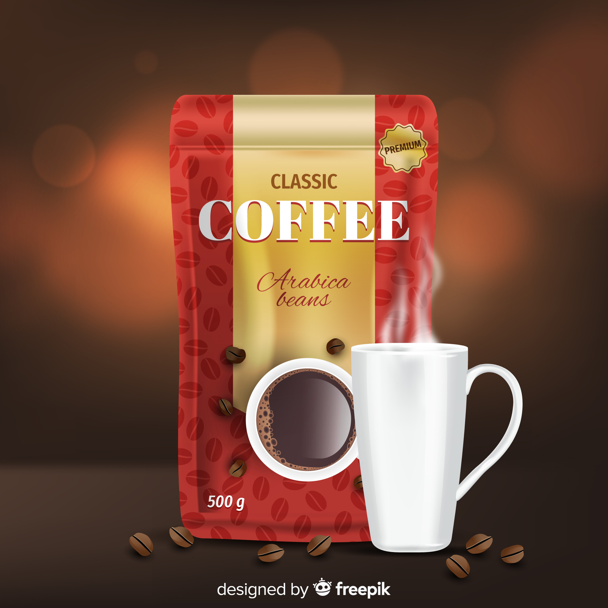

# Coffee Shop Website - HTML Components Reference

## Overview

This document provides detailed documentation for all HTML components, semantic structure, and markup patterns used in the Coffee Shop website. Each component includes proper semantic HTML, accessibility considerations, and integration guidelines.

## Table of Contents

1. [Document Structure](#document-structure)
2. [Header Components](#header-components)
3. [Navigation Components](#navigation-components)
4. [Content Sections](#content-sections)
5. [Form Components](#form-components)
6. [Media Components](#media-components)
7. [Footer Components](#footer-components)
8. [Accessibility Features](#accessibility-features)
9. [SEO Optimization](#seo-optimization)

---

## Document Structure

### HTML5 Document Template
**Location:** Lines 1-17 in `index.html`

```html
<!DOCTYPE html>
<html lang="en">
<head>
    <meta charset="UTF-8" />
    <meta name="viewport" content="width=device-width, initial-scale=1.0" />
    <title>Coffee Shop</title>
    
    <!-- External Resources -->
    <link rel="stylesheet" href="https://cdnjs.cloudflare.com/ajax/libs/font-awesome/6.7.2/css/all.min.css" 
          integrity="sha512-Evv84Mr4kqVGRNSgIGL/F/aIDqQb7xQ2vcrdIwxfjThSH8CSR7PBEakCr51Ck+w+/U6swU2Im1vVX0SVk9ABhg==" 
          crossorigin="anonymous" 
          referrerpolicy="no-referrer" />
    <link rel="shortcut icon" href="images/logo.jpg" type="image/x-icon">
    <link rel="stylesheet" href="style.css" />
</head>
<body>
    <!-- Website content -->
    <script src="main.js"></script>
</body>
</html>
```

**Key Features:**
- **DOCTYPE:** HTML5 declaration
- **Language:** `lang="en"` for accessibility
- **Charset:** UTF-8 for international characters
- **Viewport:** Responsive meta tag for mobile devices
- **Security:** Integrity checks for CDN resources
- **Performance:** CSS in head, JS before closing body tag

### Meta Tags and External Resources

#### Required Meta Tags
```html
<meta charset="UTF-8" />
<meta name="viewport" content="width=device-width, initial-scale=1.0" />
<title>Coffee Shop</title>
```

#### External Dependencies
```html
<!-- Font Awesome Icons -->
<link rel="stylesheet" 
      href="https://cdnjs.cloudflare.com/ajax/libs/font-awesome/6.7.2/css/all.min.css" 
      integrity="sha512-Evv84Mr4kqVGRNSgIGL/F/aIDqQb7xQ2vcrdIwxfjThSH8CSR7PBEakCr51Ck+w+/U6swU2Im1vVX0SVk9ABhg==" 
      crossorigin="anonymous" 
      referrerpolicy="no-referrer" />

<!-- Favicon -->
<link rel="shortcut icon" href="images/logo.jpg" type="image/x-icon">

<!-- Main Stylesheet -->
<link rel="stylesheet" href="style.css" />
```

---

## Header Components

### Main Header Structure
**Location:** Lines 18-36 in `index.html`

```html
<header>
    <a class="logo" href="#">
        
    </a>
    <nav class="navbar">
        <a href="#">Home</a>
        <a href="#">About</a>
        <a href="#">menu</a>
        <a href="#">products</a>
        <a href="#">reviews</a>
        <a href="#">contact</a>
        <a href="#">blogs</a>
    </nav>
    <div class="icons">
        <i class="fa-solid fa-magnifying-glass"></i>
        <i class="fa-solid fa-cart-shopping"></i>
        <i class="fa-solid fa-bars" id="menu-btn"></i>
    </div>
</header>
```

**Component Breakdown:**

#### Logo Component
```html
<a class="logo" href="#">
    
</a>
```

**Features:**
- **Semantic:** Anchor tag for navigation
- **Accessibility:** Descriptive alt text
- **Functionality:** Links to homepage
- **Styling:** `.logo` class for CSS targeting

**Best Practices:**
```html
<!-- Improved accessibility -->
<a class="logo" href="#" aria-label="Coffee Shop Homepage">
    
</a>
```

#### Navigation Component
```html
<nav class="navbar">
    <a href="#">Home</a>
    <a href="#">About</a>
    <a href="#">menu</a>
    <a href="#">products</a>
    <a href="#">reviews</a>
    <a href="#">contact</a>
    <a href="#">blogs</a>
</nav>
```

**Features:**
- **Semantic:** `<nav>` element for navigation
- **Structure:** Simple anchor links
- **Responsive:** Hidden on mobile, toggled by JavaScript

**Enhanced Version:**
```html
<nav class="navbar" role="navigation" aria-label="Main navigation">
    <a href="#home">Home</a>
    <a href="#about">About</a>
    <a href="#menu">Menu</a>
    <a href="#products">Products</a>
    <a href="#reviews">Reviews</a>
    <a href="#contact">Contact</a>
    <a href="#blogs">Blogs</a>
</nav>
```

#### Icons Component
```html
<div class="icons">
    <i class="fa-solid fa-magnifying-glass"></i>
    <i class="fa-solid fa-cart-shopping"></i>
    <i class="fa-solid fa-bars" id="menu-btn"></i>
</div>
```

**Features:**
- **Icons:** Font Awesome classes
- **Functionality:** Search, cart, mobile menu toggle
- **Responsive:** Visible only on mobile/tablet

**Accessible Version:**
```html
<div class="icons">
    <button aria-label="Search" class="icon-btn">
        <i class="fa-solid fa-magnifying-glass"></i>
    </button>
    <button aria-label="Shopping Cart" class="icon-btn">
        <i class="fa-solid fa-cart-shopping"></i>
    </button>
    <button aria-label="Toggle Menu" id="menu-btn" class="icon-btn">
        <i class="fa-solid fa-bars"></i>
    </button>
</div>
```

---

## Navigation Components

### Primary Navigation Pattern
**Usage:** Main site navigation
**Structure:** Horizontal menu with hover effects

```html
<nav class="navbar">
    <a href="#section">Section Name</a>
    <!-- Repeat for each section -->
</nav>
```

### Footer Navigation Pattern
**Location:** Lines 340-348 in `index.html`

```html
<div class="links">
    <a href="#">Home</a>
    <a href="#">About</a>
    <a href="#">menu</a>
    <a href="#">products</a>
    <a href="#">reviews</a>
    <a href="#">contact</a>
    <a href="#">blogs</a>
</div>
```

**Features:**
- **Consistency:** Matches header navigation
- **Styling:** Different visual treatment
- **Accessibility:** Same link structure

---

## Content Sections

### Hero Section (Home)
**Location:** Lines 37-49 in `index.html`

```html
<section class="home">
    <div class="content">
        <h3>Fresh Coffee in the Morning</h3>
        <p>Lorem ipsum dolor sit amet consectetur adipisicing elit...</p>
        <button class="btn">Get Yours Now</button>
    </div>
</section>
```

**Structure:**
- **Container:** `<section>` with class for styling
- **Content Wrapper:** `<div class="content">` for layout
- **Hierarchy:** H3 heading, paragraph, call-to-action button

**Semantic Improvements:**
```html
<section class="home" role="banner">
    <div class="content">
        <h1>Fresh Coffee in the Morning</h1>
        <p>Experience the finest coffee beans, expertly roasted and brewed to perfection...</p>
        <a href="#menu" class="btn" role="button">Get Yours Now</a>
    </div>
</section>
```

### About Section
**Location:** Lines 50-62 in `index.html`

```html
<section class="about">
    <h1 class="heading"><span>about</span>us</h1>
    <div class="row">
        <div class="image">
            
        </div>
        <div class="content">
            <h3>Lorem ipsum dolor sit amet.</h3>
            <p>Lorem ipsum dolor, sit amet consectetur adipisicing elit...</p>
            <button class="btn">Learn More</button>
        </div>
    </div>
</section>
```

**Layout Pattern:**
- **Section Heading:** Consistent heading with span highlighting
- **Two-Column Layout:** Image and content side by side
- **Content Hierarchy:** H3 subheading, paragraph, CTA button

**Improved Accessibility:**
```html
<section class="about" id="about">
    <h2 class="heading"><span>about</span> us</h2>
    <div class="row">
        <div class="image">
            
        </div>
        <div class="content">
            <h3>Our Story</h3>
            <p>Founded in 2020, we are passionate about serving the finest coffee...</p>
            <a href="#contact" class="btn">Learn More</a>
        </div>
    </div>
</section>
```

### Grid Section Pattern (Menu, Products, Reviews, Blogs)
**Usage:** Sections with multiple items in grid layout

```html
<section class="section-name">
    <h1 class="heading"><span>highlighted</span>text</h1>
    <div class="box-container">
        <div class="box">
            <!-- Item content -->
        </div>
        <!-- Repeat for multiple items -->
    </div>
</section>
```

#### Menu Section
**Location:** Lines 63-119 in `index.html`

```html
<section class="menu">
    <h1 class="heading"><span>our</span>menu</h1>
    <div class="box-container">
        <div class="box">
            
            <h3>taty and healthy</h3>
            <div class="price">$14.99 <span>$19.99</span></div>
            <div class="btn">Buy Now</div>
        </div>
        <!-- Repeat for menu items 2-10 -->
    </div>
</section>
```

**Item Structure:**
- **Image:** Product photo
- **Title:** Item name (H3)
- **Price:** Current and original price
- **Action:** Buy now button

**Enhanced Version:**
```html
<section class="menu" id="menu">
    <h2 class="heading"><span>our</span> menu</h2>
    <div class="box-container">
        <article class="box">
            
            <h3>Premium Espresso</h3>
            <div class="price">
                <span class="current">$3.99</span>
                <span class="original">$5.99</span>
            </div>
            <button class="btn" data-item="espresso">Add to Cart</button>
        </article>
        <!-- Repeat for other items -->
    </div>
</section>
```

#### Products Section
**Location:** Lines 120-188 in `index.html`

```html
<section class="products">
    <h1 class="heading"><span>our</span>products</h1>
    <div class="box-container">
        <div class="product-box">
            <div class="image">
                
            </div>
            <div class="content">
                <h3>Fresh Coffee</h3>
                <div class="stars">
                    <i class="fa-solid fa-star"></i>
                    <i class="fa-solid fa-star"></i>
                    <i class="fa-solid fa-star"></i>
                    <i class="fa-solid fa-star"></i>
                    <i class="fa-solid fa-star"></i>
                </div>
                <div class="price">$12.99 <span>$19.99</span></div>
            </div>
        </div>
        <!-- Repeat for products 2-4 -->
    </div>
</section>
```

**Product Structure:**
- **Image Container:** Separate div for image
- **Content Container:** Product details
- **Star Rating:** Visual rating display
- **Pricing:** Current and original prices

#### Reviews Section
**Location:** Lines 189-230 in `index.html`

```html
<section class="reviews">
    <h1 class="heading"><span>customer's</span>reviews</h1>
    <div class="box-container">
        <div class="box">
            <p>Lorem ipsum, dolor sit amet consectetur adipisicing elit...</p>
            
            <h3>Musa A.</h3>
            <div class="stars">
                <i class="fa-solid fa-star"></i>
                <i class="fa-solid fa-star"></i>
                <i class="fa-solid fa-star"></i>
                <i class="fa-solid fa-star"></i>
                <i class="fa-solid fa-star"></i>
            </div>
        </div>
        <!-- Repeat for users 2-3 -->
    </div>
</section>
```

**Review Structure:**
- **Testimonial:** Customer quote
- **Photo:** Customer image
- **Name:** Customer name
- **Rating:** Star rating

#### Blogs Section
**Location:** Lines 261-329 in `index.html`

```html
<section class="blogs" id="blogs">
    <h1 class="heading">our <span>blogs</span></h1>
    <div class="box-container">
        <div class="box">
            <div class="image">
                
            </div>
            <div class="content">
                <a href="#" class="title">tasty and refreshing</a>
                <span>by admin /22.10.2025</span>
                <p>Lorem ipsum dolor sit amet consectetur adipisicing elit...</p>
                <button class="btn">read More</button>
            </div>
        </div>
        <!-- Repeat for blogs 2-4 -->
    </div>
</section>
```

**Blog Post Structure:**
- **Image:** Featured image with hover effect
- **Title:** Clickable blog title
- **Meta:** Author and date information
- **Excerpt:** Blog post preview
- **CTA:** Read more button

---

## Form Components

### Contact Form
**Location:** Lines 235-256 in `index.html`

```html
<form>
    <h3>get in touch</h3>
    <div class="input-box">
        <span><i class="fa-solid fa-user"></i></span>
        <input type="text" placeholder="name">
    </div>
    <div class="input-box">
        <span><i class="fa-solid fa-envelope"></i></span>
        <input type="email" placeholder="email">
    </div>
    <div class="input-box">
        <span><i class="fa-solid fa-phone"></i></span>
        <input type="number" placeholder="phone">
    </div>
    <div class="btn-container">
        <button class="btn">send</button>
    </div>
</form>
```

### Input Box Pattern
**Structure:** Icon + Input field wrapper

```html
<div class="input-box">
    <span><i class="fa-solid fa-icon-name"></i></span>
    <input type="text" placeholder="placeholder text">
</div>
```

**Input Types Available:**
- **Text:** `type="text"` for names, general text
- **Email:** `type="email"` for email addresses
- **Tel:** `type="tel"` for phone numbers
- **Number:** `type="number"` for numeric input

**Enhanced Accessibility Version:**
```html
<form method="POST" action="/contact" novalidate>
    <h3>Get in Touch</h3>
    
    <div class="input-box">
        <label for="name">
            <span><i class="fa-solid fa-user" aria-hidden="true"></i></span>
            <input type="text" id="name" name="name" placeholder="Your Name" required 
                   aria-describedby="name-error">
        </label>
        <div id="name-error" class="error-message" aria-live="polite"></div>
    </div>
    
    <div class="input-box">
        <label for="email">
            <span><i class="fa-solid fa-envelope" aria-hidden="true"></i></span>
            <input type="email" id="email" name="email" placeholder="Your Email" required
                   aria-describedby="email-error">
        </label>
        <div id="email-error" class="error-message" aria-live="polite"></div>
    </div>
    
    <div class="input-box">
        <label for="phone">
            <span><i class="fa-solid fa-phone" aria-hidden="true"></i></span>
            <input type="tel" id="phone" name="phone" placeholder="Your Phone"
                   aria-describedby="phone-error">
        </label>
        <div id="phone-error" class="error-message" aria-live="polite"></div>
    </div>
    
    <div class="btn-container">
        <button type="submit" class="btn">Send Message</button>
    </div>
</form>
```

---

## Media Components

### Image Patterns

#### Logo Image
```html

```

#### Content Images
```html
<!-- About section image -->


<!-- Menu item images -->


<!-- Product images -->


<!-- User photos -->


<!-- Blog images -->

```

**Image Optimization Guidelines:**
- **Alt Text:** Descriptive, not decorative
- **File Names:** Descriptive and SEO-friendly
- **Formats:** JPEG for photos, PNG for graphics
- **Sizes:** Optimized for web delivery

### Embedded Media

#### Google Maps Integration
**Location:** Lines 234-234 in `index.html`

```html
<iframe class="map" 
        src="https://www.google.com/maps/embed?pb=!1m18!1m12!1m3!1d14920.334355680021!2d31.99659832301541!3d36.54578344424385!2m3!1f0!2f0!3f0!3m2!1i1024!2i768!4f13.1!3m3!1m2!1s0x14dca27b822cd5fb%3A0xd160c1c8b3dc170b!2sAlanya%2C%20Antalya!5e0!3m2!1str!2str!4v1742052123943!5m2!1str!2str" 
        width="600" 
        height="450" 
        style="border:0;" 
        allowfullscreen="" 
        loading="lazy" 
        referrerpolicy="no-referrer-when-downgrade">
</iframe>
```

**Features:**
- **Responsive:** Styled with CSS for responsive behavior
- **Performance:** Lazy loading enabled
- **Security:** Referrer policy for privacy
- **Accessibility:** Allowfullscreen for user control

---

## Footer Components

### Footer Structure
**Location:** Lines 330-351 in `index.html`

```html
<footer>
    <section>
        <div class="share">
            <i class="fa-brands fa-facebook"></i>
            <i class="fa-brands fa-instagram"></i>
            <i class="fa-brands fa-x-twitter"></i>
            <i class="fa-brands fa-pinterest"></i>
            <i class="fa-brands fa-linkedin"></i>
        </div>
        <div class="links">
            <a href="#">Home</a>
            <a href="#">About</a>
            <a href="#">menu</a>
            <a href="#">products</a>
            <a href="#">reviews</a>
            <a href="#">contact</a>
            <a href="#">blogs</a>
        </div>
        <div class="copyright">
            created by <span>Musa Akyıl</span> all rights reserved
        </div>
    </section>
</footer>
```

### Social Media Links
```html
<div class="share">
    <i class="fa-brands fa-facebook"></i>
    <i class="fa-brands fa-instagram"></i>
    <i class="fa-brands fa-x-twitter"></i>
    <i class="fa-brands fa-pinterest"></i>
    <i class="fa-brands fa-linkedin"></i>
</div>
```

**Enhanced Version:**
```html
<div class="share">
    <a href="https://facebook.com/coffeeshop" aria-label="Facebook">
        <i class="fa-brands fa-facebook" aria-hidden="true"></i>
    </a>
    <a href="https://instagram.com/coffeeshop" aria-label="Instagram">
        <i class="fa-brands fa-instagram" aria-hidden="true"></i>
    </a>
    <a href="https://twitter.com/coffeeshop" aria-label="Twitter">
        <i class="fa-brands fa-x-twitter" aria-hidden="true"></i>
    </a>
    <a href="https://pinterest.com/coffeeshop" aria-label="Pinterest">
        <i class="fa-brands fa-pinterest" aria-hidden="true"></i>
    </a>
    <a href="https://linkedin.com/company/coffeeshop" aria-label="LinkedIn">
        <i class="fa-brands fa-linkedin" aria-hidden="true"></i>
    </a>
</div>
```

---

## Accessibility Features

### Current Accessibility

#### Positive Features
- **Alt Text:** Images have alt attributes
- **Semantic HTML:** Proper use of header, nav, section, footer
- **Language:** HTML lang attribute set
- **Viewport:** Mobile-responsive meta tag

#### Areas for Improvement

##### 1. Heading Hierarchy
**Current:** Multiple H1 tags, inconsistent hierarchy
**Improved:**
```html
<h1>Coffee Shop</h1>          <!-- Main page title -->
<h2 class="heading">About Us</h2>    <!-- Section headings -->
<h3>Product Name</h3>         <!-- Subsection headings -->
```

##### 2. Form Labels
**Current:** No labels, only placeholders
**Improved:**
```html
<label for="name">Name</label>
<input type="text" id="name" name="name" placeholder="Your name">
```

##### 3. Link Context
**Current:** Generic "Learn More" links
**Improved:**
```html
<a href="#about">Learn More About Our Coffee Shop</a>
```

##### 4. Icon Accessibility
**Current:** Decorative icons without labels
**Improved:**
```html
<button aria-label="Toggle mobile menu">
    <i class="fa-solid fa-bars" aria-hidden="true"></i>
</button>
```

### WCAG Compliance Checklist

#### Level A Requirements
- [x] Images have alt text
- [x] Page has title
- [x] HTML is valid
- [ ] Proper heading structure
- [ ] Form inputs have labels
- [ ] Links have descriptive text

#### Level AA Requirements
- [ ] Color contrast ratio 4.5:1
- [ ] Text can be resized to 200%
- [ ] Content is keyboard accessible
- [ ] Focus indicators visible

---

## SEO Optimization

### Current SEO Elements

#### Meta Information
```html
<title>Coffee Shop</title>
<meta charset="UTF-8" />
<meta name="viewport" content="width=device-width, initial-scale=1.0" />
```

#### Structured Content
- **Headings:** H1, H2, H3 hierarchy
- **Semantic HTML:** Proper element usage
- **Alt Text:** Image descriptions

### SEO Improvements

#### Enhanced Meta Tags
```html
<title>Best Coffee Shop - Fresh Roasted Beans & Artisan Drinks</title>
<meta name="description" content="Experience the finest coffee at our local coffee shop. Fresh roasted beans, artisan drinks, and cozy atmosphere. Visit us today!">
<meta name="keywords" content="coffee shop, fresh coffee, espresso, latte, local cafe">

<!-- Open Graph -->
<meta property="og:title" content="Coffee Shop - Fresh Roasted Coffee">
<meta property="og:description" content="Experience the finest coffee at our local coffee shop">
<meta property="og:image" content="images/logo.jpg">
<meta property="og:url" content="https://yourwebsite.com">

<!-- Twitter Card -->
<meta name="twitter:card" content="summary_large_image">
<meta name="twitter:title" content="Coffee Shop - Fresh Roasted Coffee">
<meta name="twitter:description" content="Experience the finest coffee at our local coffee shop">
```

#### Structured Data
```html
<script type="application/ld+json">
{
  "@context": "https://schema.org",
  "@type": "CafeOrCoffeeShop",
  "name": "Coffee Shop",
  "description": "Local coffee shop serving fresh roasted beans",
  "address": {
    "@type": "PostalAddress",
    "streetAddress": "123 Main Street",
    "addressLocality": "City",
    "addressRegion": "State",
    "postalCode": "12345"
  },
  "telephone": "+1-555-123-4567",
  "openingHours": "Mo-Fr 07:00-19:00, Sa-Su 08:00-20:00"
}
</script>
```

#### Internal Linking
```html
<!-- Navigation with anchor links -->
<nav class="navbar">
    <a href="#home">Home</a>
    <a href="#about">About</a>
    <a href="#menu">Menu</a>
    <a href="#products">Products</a>
    <a href="#reviews">Reviews</a>
    <a href="#contact">Contact</a>
    <a href="#blogs">Blogs</a>
</nav>

<!-- Section IDs -->
<section class="home" id="home">
<section class="about" id="about">
<section class="menu" id="menu">
<!-- etc. -->
```

---

## Component Usage Guidelines

### HTML Best Practices

#### 1. Semantic Structure
```html
<!-- Good -->
<header>
    <nav>
        <ul>
            <li><a href="#home">Home</a></li>
        </ul>
    </nav>
</header>

<!-- Better -->
<header role="banner">
    <nav role="navigation" aria-label="Main navigation">
        <ul>
            <li><a href="#home">Home</a></li>
        </ul>
    </nav>
</header>
```

#### 2. Progressive Enhancement
```html
<!-- Base functionality works without JavaScript -->
<a href="menu.html" class="btn">View Menu</a>

<!-- Enhanced with JavaScript -->
<button class="btn" onclick="showMenu()">View Menu</button>
```

#### 3. Mobile-First Approach
```html
<!-- Responsive images -->

```

### Validation and Testing

#### HTML Validation
- **W3C Validator:** Check for syntax errors
- **Accessibility:** Use WAVE or axe tools
- **Performance:** Test with Lighthouse

#### Browser Testing
- **Cross-browser:** Test in Chrome, Firefox, Safari, Edge
- **Mobile:** Test on actual devices
- **Screen Readers:** Test with NVDA, JAWS, VoiceOver

This HTML Components Reference provides complete documentation of all markup patterns, semantic structure, and best practices for the Coffee Shop website.